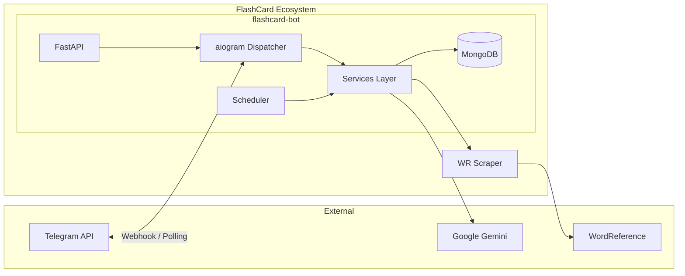
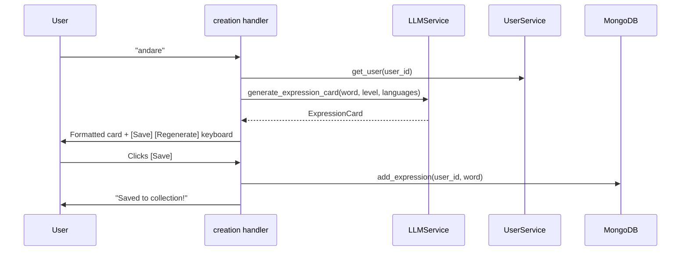
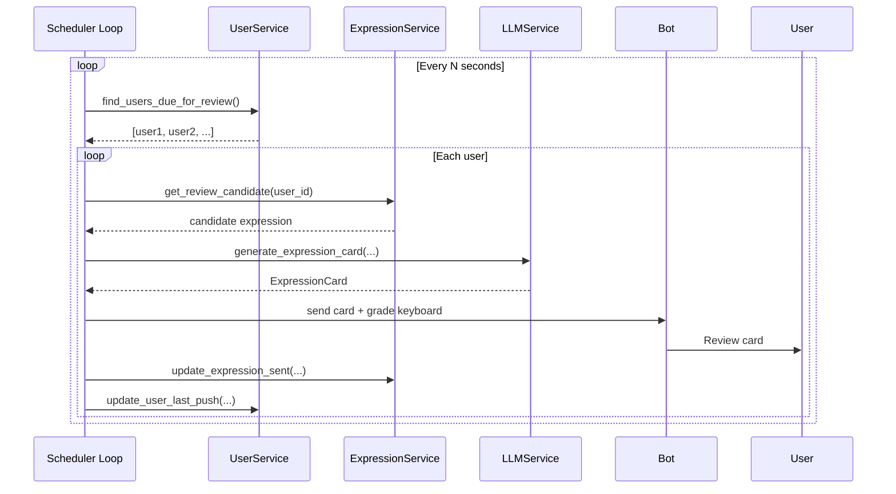
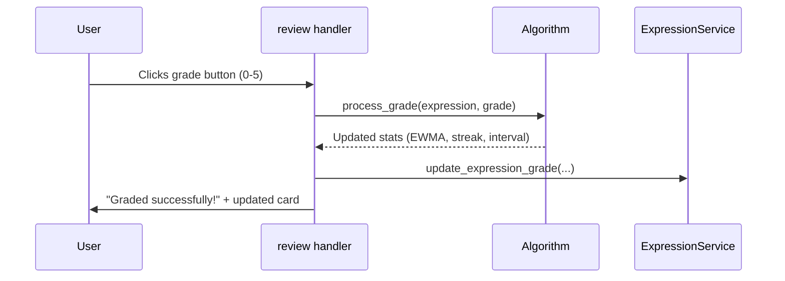

# Architecture

This document describes the system architecture of the FlashCard Bot ecosystem.

## System Overview



## Package Structure

```
flashcard-project/src/flashcard/
├── __main__.py              # Entry points (FastAPI app + local dev polling shortcut)
├── settings.py              # Pydantic settings (env vars)
├── language.py              # LanguageConfig: the instance's language, built once per startup
├── composition.py           # Composition root: shared clients, services, use cases
│
├── app/                     # Use cases: the flows handlers and the scheduler call
│   ├── review.py            # Prepare, send and grade reviews (+ stored-card fallback)
│   ├── review_schedule.py   # Pure scheduler rules (interval, pause, shadow compare)
│   ├── creation.py          # Text-to-card, regenerate, save
│   ├── collection.py        # /import, list, search, remove
│   ├── settings.py          # /settings, pause/resume
│   ├── story.py             # /story
│   ├── verb.py              # /verb lookups
│   ├── quota.py             # QuotaPolicy: tier limits, trial, own key
│   ├── shadow.py            # Shadow writes for the review-state migration (temporary)
│   └── types.py             # Types shared across use cases
│
├── api/                     # FastAPI layer
│   ├── main.py              # App and routers
│   ├── lifecycle/           # Lifespan: runs the bot via running_bot
│   ├── routes/              # HTTP endpoints (health, webhook)
│   └── schemas/             # API request/response models
│
├── db/                      # Database
│   └── mongo.py             # MongoDB client, collections, pool monitoring
│
├── migrations/              # One-off data migrations for the rollout (removed after)
│
├── scheduler/               # Background scheduler
│   └── scheduler.py         # Periodic review push loop
│
├── schemas/                 # Shared data models
│   ├── defaults.py          # Scheduler interval constant
│   ├── user.py              # UserDB model
│   ├── expression.py        # ExpressionDB / ExpressionCard / StoredCard
│   ├── languages.py         # Language codes, levels, flags
│   ├── conjugations.py      # Verb conjugation models
│   ├── story.py             # Story response model
│   ├── import_model.py      # Import parsing model
│   ├── api_key.py           # LLM API key file model and loader
│   └── trace.py             # TraceData / Span schema models
│
├── services/                # Data owners: each gets only its own collection
│   ├── expression.py        # Cards: CRUD + review candidate selection
│   ├── user.py              # User profile, settings, onboarding, last_seen_at
│   ├── consumption.py       # Usage counters
│   ├── review_state.py      # ReviewStateStore: current review, last graded
│   ├── verb.py              # Verb lookup (DB cache + scraper API)
│   ├── language_validation.py # Input validators per language
│   ├── i18n.py              # Internationalization (JSON locale files)
│   ├── http_client.py       # Shared httpx client
│   ├── trace_logger.py      # Flat-file async execution tracing
│   ├── llm/                 # LLM integration
│   │   ├── llm.py           # LLMService (card gen, stories, import parsing)
│   │   ├── llm_key.py       # API key resolution
│   │   └── prompts.py       # System prompts & function declarations
│   └── algorithm/           # Spaced repetition
│       ├── priority.py      # Review priority calculation
│       └── grading.py       # Grade processing & scheduling
│
├── telegram/                # Telegram bot layer
│   ├── bot.py               # Dispatcher setup and Telegram runtime (start/stop, running_bot)
│   ├── middlewares/         # aiogram middlewares
│   │   ├── trace_middleware.py   # Trace context per update; records the user as seen
│   │   └── timeout_middleware.py # Per-handler timeout
│   ├── keyboards.py         # Reply keyboard builder
│   ├── filters.py           # ButtonText: reply-button filter using the injected i18n
│   ├── handlers/            # Command, callback & message handlers
│   ├── helpers/             # Telegram-specific utilities
│   │   └── callback_utils.py
│   ├── ui/                  # Message formatters
│   │   ├── expression.py    # Review card formatting
│   │   ├── expression_lists.py
│   │   ├── review_label.py  # "Saved version" label
│   │   ├── verb.py          # Verb conjugation formatting
│   │   ├── story.py         # Story formatting
│   │   └── factories/       # Callback data factories
│   └── states/              # FSM state definitions
│
├── utils/                   # General utilities
│   ├── logger.py            # Logging setup
│   ├── tracing.py           # Trace/span helpers, @observe, and finalize_trace lifecycle helper
│   ├── asyncio_errors.py    # Reports unhandled asyncio errors to the logger bot
│   └── time.py              # UTC time helpers
│
└── resources/               # Static resources
    └── locales/
        ├── en.json          # English UI strings
        └── it.json          # Italian UI strings

tests/                           # Test suite (unit, integration, smoke)
├── conftest.py                  # Env var setup & autouse router state isolation fixtures
├── helpers.py                   # Shared test utilities (TEST_LANGUAGE, AsyncCursorMock)
├── unit/                        # Mocked unit tests + architecture guards (test_*_contract, test_data_ownership, test_composition_root)
│   ├── algorithm/               # Grading & priority tests
│   ├── api/                     # Webhook route tests
│   ├── app/                     # Use-case tests
│   ├── migrations/              # Migration tests
│   ├── services/                # Service layer tests
│   ├── schemas/                 # Pydantic model tests
│   ├── telegram/                # UI, keyboards, callback, handler flow tests
│   ├── scheduler/               # Scheduler logic tests
│   └── utils/                   # Tracing & time utility tests
├── integration/                 # Dispatcher, review-state, stored-card and lifecycle tests
└── smoke/                       # System-level ecosystem smoke checks
```

## Data Flow

### Card Creation (User sends a word)



### Scheduled Review



### Review Grading



## Router Registration Order

Routers are registered in strict priority order. **The first matching handler wins** — later routers are never checked for that update.

| Priority | Module | Handles | Why this position |
|----------|--------|---------|-------------------|
| 1 | `user_settings` | Settings FSM states | FSM states must be checked first |
| 2 | `feedback` | `/feedback` + FSM | FSM takes priority over commands |
| 3 | `reply_commands` | Reply keyboard text | Text-to-command mapping before other text handlers |
| 4 | `start` | `/start`, `/help` | Core commands |
| 5 | `review` | `/get` + grade callbacks | Domain feature |
| 6 | `verb` | `/verb` + conjugation callbacks | Domain feature |
| 7 | `story` | `/story` | Domain feature |
| 8 | `collection` | `/import`, `/list_my_flashcards` | Domain feature |
| 9 | `unknown` | `F.text.startswith("/")` | Catches unrecognized `/commands` |
| 10 | `creation` | `F.text` (any plain text) | Broadest text catch-all |
| 11 | `errors` | Unhandled errors | Last resort |

> [!IMPORTANT]
> The `unknown` router **must** come after all command routers (5–8) but before `creation`. Otherwise it would intercept valid commands like `/verb` as "unknown".

## Bot Initialization

The bot supports two modes:

| Mode | Entry Point | How it works |
|------|-------------|--------------|
| **FastAPI App** | `flashcard-bot` / `flashcard-bot-dev` | FastAPI app with health + webhook endpoints; Telegram delivery chosen by config |
| **Standalone Dev Polling** | `flashcard-bot-dev-poll` | `running_bot` in polling mode, no HTTP server, for local development only |

The production app initializes the same services and scheduler in both polling and webhook mode. The difference is how Telegram updates arrive (`TELEGRAM_DELIVERY_MODE=webhook` vs `polling`). `flashcard-bot-dev-poll` remains as a lightweight local shortcut when no HTTP server is needed.

### Webhook Failure Semantics

- Invalid webhook JSON payloads return `400 Bad Request`.
- Invalid Telegram update payloads return `400 Bad Request`.
- Dispatcher processing failures return `500 Internal Server Error` so Telegram can retry update delivery.
- Health checks return `503 Service Unavailable` if the database is unreachable, enabling automated container recovery.
- Webhook processing failures are logged and trigger best-effort admin notification through logger bot.

## Dependency Injection

One composition root, [`composition.py`](../src/flashcard/composition.py), wires everything:
`open_resources` opens Mongo and the HTTP client once, and `build_core` builds every service and
use case into a `Core`. [`bot.py`](../src/flashcard/telegram/bot.py) runs Telegram on top of it
(`running_bot` → `start_telegram`); the FastAPI lifespan and the dev polling entry point both use
`running_bot`, so wiring is identical in every mode.

Handlers receive `Core.handler_data(logger_bot)` through aiogram's keyword injection: use cases,
`language` and `logger_bot` (plus `user_service`, for `TraceMiddleware` only). Handlers never get a
service directly (guarded by `tests/unit/test_composition_root.py`):

```python
# In any handler — aiogram injects by parameter name
async def cmd_get(message: Message, review_use_cases: ReviewUseCases, language: LanguageConfig):
    ...
```

## Tracing Flow

- Telegram updates are traced by [`trace_middleware.py`](../src/flashcard/telegram/middlewares/trace_middleware.py), which injects `trace_id` into handler context and attaches it to raised exceptions for global error handlers.
- Scheduler cycles create their own trace context in [`scheduler.py`](../src/flashcard/scheduler/scheduler.py), so scheduler admin alerts also include trace IDs.
- Both paths finalize traces through `finalize_trace(...)` in [`utils/tracing.py`](../src/flashcard/utils/tracing.py).
- Background asyncio task failures (for example, chat-action worker tasks) are captured by [`utils/asyncio_errors.py`](../src/flashcard/utils/asyncio_errors.py), logged via the `flashcard.*` logger, and handled with shutdown-safe admin notification scheduling.

## Error Mapping Logic

The global error handler in [`errors.py`](../src/flashcard/telegram/handlers/errors.py) uses a centralized exception-to-i18n-key mapping. This ensures consistent user feedback without scattering `try/except` blocks in every handler:

1. Handlers perform domain-specific work (LLM calls, DB queries).
2. If an exception bubbles up to the dispatcher, the global error handler catches it.
3. It checks the exception type against `_ERROR_MESSAGE_MAP` (e.g., `GeminiAPIError`, `PyMongoError`).
4. If a match is found, the user receives a specific friendly message (e.g., "AI overloaded").
5. Otherwise, it falls back to the generic `service_unavailable` message.

## Database Collections

| Collection | Schema | Purpose |
|------------|--------|---------|
| `users` | `UserDB` | User profiles, settings, scheduling state |
| `expressions` | `ExpressionDB` | Saved flashcards with review stats |
| `conjugations` | — | Cached verb conjugation data |
